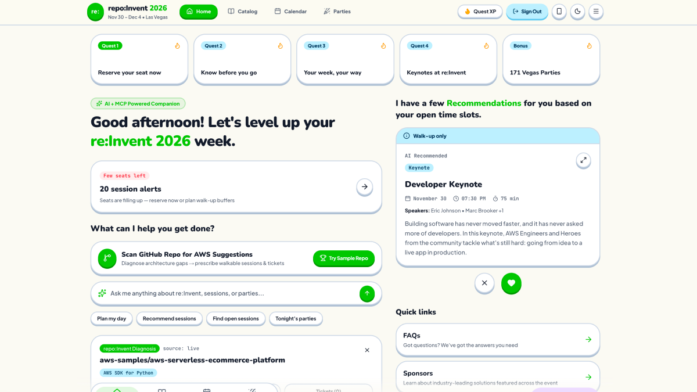

# repo:Invent — AWS re:Invent 2026 Companion App, Architecture Scanner & MCP Agent

**re:Invent tells you what is new. `repo:Invent` tells you what your repository is missing—and plans your entire week in Las Vegas.**

Built for the **AWS re:Invent 2026 Event Catalog API Hackathon**, `repo:Invent` combines the full official AWS re:Invent mobile companion experience with static GitHub repository analysis, 10-minute seat forfeiture transit guards, 171 community & sponsor parties (`conferenceparties.com`), the live **AWS Events Remote MCP Server** (`https://api.awsevents.com/mcp`), and in-browser **WebMCP** (`navigator.modelContext`).

- **Live Demo (AWS Amplify):** [https://main.d2cc7k0mucngnf.amplifyapp.com/](https://main.d2cc7k0mucngnf.amplifyapp.com/)




---

## What This Project Does

When developers attend AWS re:Invent, they face 2,200+ sessions across 6 Las Vegas casinos. Choosing sessions by keyword alone often misses the fundamental architectural improvements their actual codebase needs.

`repo:Invent` solves this by connecting code to conference:

1. **Scan 1 (The Repo Scanner)**: Paste any GitHub repository URL (e.g. `codercatdev/repo-invent` or `aws-samples/aws-serverless-ecommerce-platform`) right on the home screen above "Ask me anything...".
2. **Scan 2 (Architecture Diagnosis & Schedule Prescription)**: The scanner inspects your CDK stacks, Terraform configurations, Dockerfiles, and application code. It identifies architectural gaps (e.g. Lambda without OpenTelemetry, unthrottled public APIs, unbuffered DynamoDB writes, or wildcards in IAM policies), calculates target difficulty levels (300/400), and outputs a curated week plan of sessions that directly remediate those gaps.
3. **171 Curated Vegas Parties**: Scraped and enriched from `conferenceparties.com` with one-click "+ Calendar" overlays, venue filters, and RSVP links.
4. **Interactive MCP & WebMCP Assistant**: Floating `✦` button connects directly to the official `https://api.awsevents.com/mcp` endpoint and exposes browser tools via `window.webMcp`.
5. **Tactile Duolingo Aesthetic**: Playful 3D tactile buttons, bouncy animations, quest XP tracking, and full responsive desktop/mobile view.

---

## Quick Start (`pnpm`)

### Prerequisites
- Node.js >= 20
- `pnpm` (v9 or v11)

```bash
git clone https://github.com/codercatdev/repo-invent.git
cd repo-invent
pnpm install
pnpm dev
```

Open [http://localhost:3000](http://localhost:3000) (or the port indicated in your console).

| Command | Description |
| --- | --- |
| `pnpm dev` | Starts the Next.js 16 (App Router + Turbopack) development server |
| `pnpm build` | Builds the production Next.js app + CLI/MCP TypeScript engine |
| `pnpm start` | Starts the production Next.js server |
| `pnpm test` | Runs the Vitest test suite (`43 passed`) |
| `pnpm typecheck` | Validates TypeScript types across both Next.js and CLI/MCP code |
| `pnpm cli login` | Runs OAuth 2.0 PKCE login with AWS Builder ID on `localhost:8484` |
| `pnpm mcp` | Starts the local stdio MCP server (`src/mcp-server.ts`) |

---

## Deploying to AWS Amplify Hosting

This application is ready to deploy on **AWS Amplify Hosting** (Next.js SSR or SSG):

### Option A: 1-Click AWS Amplify Console
1. Push your repository to GitHub.
2. Open the [AWS Amplify Console](https://console.aws.amazon.com/amplify/).
3. Choose **Create new app** > **GitHub** > select `codercatdev/repo-invent` (branch: `main`).
4. Amplify will automatically detect Next.js 16 (SSR).
5. Add the build settings below if prompted, then click **Save and deploy**.

### Amplify Build Settings (`amplify.yml`)
```yaml
version: 1
frontend:
  phases:
    preBuild:
      commands:
        - corepack enable
        - pnpm install
    build:
      commands:
        - pnpm build
  artifacts:
    baseDirectory: .next
    files:
      - '**/*'
  cache:
    paths:
      - .next/cache/**/*
      - node_modules/**/*
```

> **Note on OAuth in Cloud Deployments:** The official AWS Events API uses loopback PKCE (`http://localhost:8484-8489/callback`) for AWS Builder ID tokens. When hosted on AWS Amplify, the application runs seamlessly in **Guest Mode** (with full repo scanning, session catalog browsing, 171 party exploration, and MCP chat). Users testing the live token sync can use `pnpm dev` locally or paste an exchanged token on `/login`.

---

## Features & Screens

| Screen / Feature | What It Does | API & Data Surface |
| --- | --- | --- |
| **Home (`/`)** | Official AWS re:Invent 2026 header, Story cards carousel, dynamic seat alerts, **Scan GitHub Repo button right above Ask AWS**, Swipeable AI Recommendations (`✕` dismiss / `♥` favorite), and Quick Links | `/api/catalog`, `/api/scan`, `/api/favorite`, `/api/mcp` |
| **Session Catalog (`/catalog`)** | Full 2,476-session catalog with search, Filter sheet (Day, Level 100–500, Type, Venue, Track), quick chips (`All Day`, `Recommended`, `New launch`, `Open seats`), and collapsible Featured Experiences (`AWS Merch Store`, `Datadog Observaball`, `re:Invent SWAG`) | `ListSessions`, `GetSession` (`/api/catalog`) |
| **Your Calendar (`/calendar`)** | Month header + lavender `✦ Plan my day` pill, `Mon 30`–`Fri 4` day pills, `Hide Favorites` toggle, `+ Parties` overlay toggle, `05:30 AM`–`09:00 PM` hourly timeline grid, and floating `+` button for Personal Time blocks | `GetSchedule`, `CreatePersonalTime`, `DeletePersonalTime`, `DisassociateFavorite` |
| **171 Vegas Parties (`/parties`)** | All 171 vendor and community parties scraped from `conferenceparties.com/reinvent2026/` across 6 nights with sponsor tags, venue hubs, RSVP links, Google Maps links, and 1-click `+ Add to Calendar` | `/api/parties` (`data/parties.json`) |
| **More Menu (`☰`)** | Event switcher (`ListEvents` / `GetEvent`), Session Surveys & Reflections (rating ≥3★ closes repo architecture gaps), Builder ID PKCE status, Scannable Badge Pickup QR Code, Campus FAQs, Sponsors, and Disclosures | `/api/events`, `/api/session`, `/api/report` |
| **Floating MCP Agent (`✦`)** | Bottom-right purple sparkle Floating Action Button opens the live **MCP + WebMCP Assistant Drawer** with natural-language chat AND a 16-tool interactive MCP Inspector | `https://api.awsevents.com/mcp` + `navigator.modelContext` |

---

## MCP & WebMCP Integration

### 1. Remote AWS Events MCP Proxy (`/api/mcp`)
Connects directly to `https://api.awsevents.com/mcp` using `StreamableHTTPClientTransport` (`src/api/remote-mcp-bridge.ts`) and exposes all 12 official tools:
- `ListEvents`, `GetEvent`, `ListSessions`, `GetSession`, `GetSchedule`
- `ReserveSessions`, `CancelReservation`, `AssociateFavorites`, `DisassociateFavorite`
- `CreatePersonalTime`, `UpdatePersonalTime`, `DeletePersonalTime`

Plus 4 `repo:Invent` MCP tools:
- `scan_repository`, `search_sessions`, `search_parties`, `what_can_i_make`

### 2. Browser WebMCP (`navigator.modelContext` & `window.webMcp`)
On load, `lib/web-mcp.ts` registers our tools with the browser's `navigator.modelContext` API (`provideContext` / `registerTool`) and exposes `window.webMcp` so browser AI agents can invoke repository scans, catalog searches, party lookups, and schedule reads directly from the page.

---

## Repository Structure

```
repo-invent/
├── app/
│   ├── layout.tsx             # Root layout (Plus Jakarta Sans, Nunito, JetBrains Mono)
│   ├── page.tsx               # Home screen (Repo Scanner + AI Recommendations)
│   ├── catalog/page.tsx       # Session catalog with filter drawers
│   ├── calendar/page.tsx      # Interactive 5-day calendar timeline
│   ├── parties/page.tsx       # 171 conferenceparties.com directory
│   ├── login/page.tsx         # Dedicated Builder ID PKCE login screen
│   ├── logout/page.tsx        # Sign out screen
│   ├── api/                   # All REST endpoints & MCP server proxy
│   └── icon.svg               # Tactile green re: 3D SVG icon
├── components/
│   ├── app-shell.tsx          # Fullscreen + Mobile preview shell
│   ├── mcp-assistant-sheet.tsx# Floating MCP chat & tool inspector
│   ├── qr-code.tsx            # Pure vector SVG QR code generator
│   ├── more-sheet.tsx         # More menu & Badge pickup QR drawer
│   └── ui/                    # shadcn/ui components (buttons, cards, badges)
├── data/
│   ├── catalog-sample.json    # Live catalog fallback snapshot
│   └── parties.json           # 171 scraped Vegas parties
├── src/                       # CLI & Core Engine
│   ├── scanner/               # CDK, Terraform, Dockerfile scanner
│   ├── planner/               # Walkable Las Vegas transit scheduler
│   └── mcp-server.ts          # Stdio MCP Server implementation
└── amplify.yml                # AWS Amplify Hosting configuration
```
