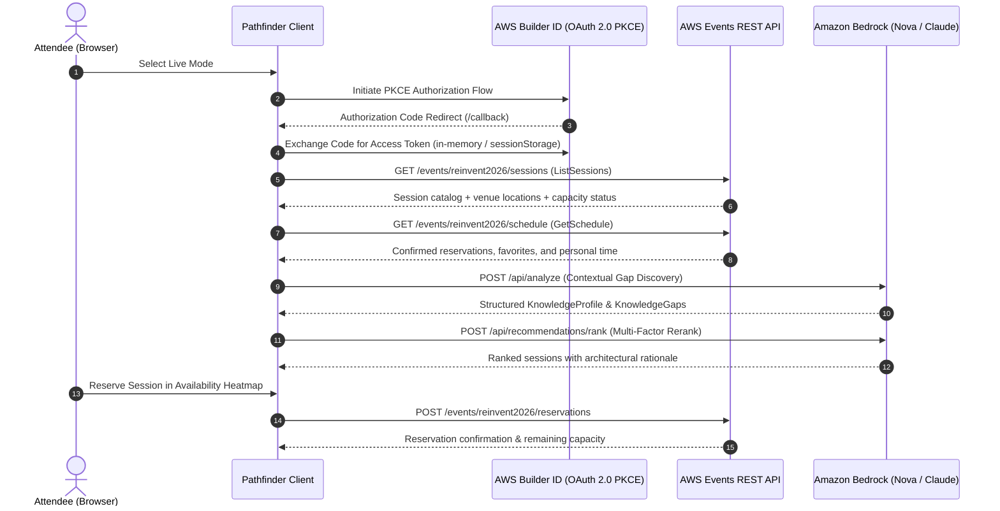

# re:Invent Pathfinder — An Adaptive Learning Journey

[](https://github.com/Trycatch-tv/reinvent-pathfinder/releases/tag/v0.22.0)
[](LICENSE)
[]()
[](https://www.typescriptlang.org/)
[](https://docs.aws.amazon.com/events/)
[](https://aws.amazon.com/bedrock/)

> **re:Invent Pathfinder** is an AI-powered companion that turns AWS re:Invent into a personalized learning journey. It identifies knowledge gaps based on what you are actually building, recommends justified sessions, visualizes seat availability at a glance through an interactive Heatmap, and adapts your learning path in real time as you attend sessions and capture reflections.

---

## Quick Links

- 🌐 **Interactive Demo (No Login Required):** [https://charlasreinvent.netlify.app/](https://charlasreinvent.netlify.app/)
- 🛠️ **AWS Builder Center Project:** [re:Invent Event Catalog API Challenge](https://builder.aws.com/build/hackathons/7c0e8c59-35d9-3ceb-8f80-0d5dc41bfebf/reinvent-event-catalog-api-hackathon?tab=projects)
- 💻 **GitHub Repository:** [https://github.com/Trycatch-tv/reinvent-pathfinder](https://github.com/Trycatch-tv/reinvent-pathfinder)
- 📺 **Build in Public Playlist (TryCatch.tv):** [YouTube Series](https://www.youtube.com/playlist?list=PLfukY7W1q_pI)
- 📖 **Deep-Dive Technical Brief:** [docs/TECHNICAL_PROJECT_BRIEF.md](docs/TECHNICAL_PROJECT_BRIEF.md)

---

## The Problem

AWS re:Invent features **over 2,000 sessions** spanning five major Vegas venues. Attendees typically face:

1. **Keyword Overload:** Searching for "Generative AI" or "Serverless" yields hundreds of disparate results with no architectural alignment.
2. **Calendar Fragmentation:** Manually juggling bookings, walk-up lines, and 45-minute venue shuttles leads to schedule conflicts and exhaustion.
3. **Static Itineraries:** If a session is full or your understanding evolves on Tuesday morning, your plan breaks down for the rest of the week.

Pathfinder starts with a fundamental question:

> **What are you building?**

Instead of matching generic role filters, Pathfinder analyzes your architectural project challenge, detects concrete knowledge gaps, recommends sessions with clear rationale, and continuously adapts your agenda.

```text
What are you building?
        ↓
Knowledge Profile & Gap Discovery
        ↓
Semantic Search & Multi-Factor Reranking
        ↓
Personalized Learning Path (Tiers & Conflict Check)
        ↓
Availability Heatmap & Live Reservations
        ↓
Attend Session & Adaptive Reflection
        ↓
Real-Time Gap Mitigation & Executive Learning Report
```

---

## What Pathfinder Does

Pathfinder orchestrates a complete 5-step adaptive journey designed around attendee needs:

### 1. Context-Aware Knowledge Profile
Captures project name, description, constraints, target seniority, and current stack (e.g. DynamoDB, Bedrock, Serverless, Zero Trust). It generates a structured technical profile without requiring pre-defined taxonomy forms.

### 2. Knowledge Gap Discovery
Pinpoints explicit architectural and operational gaps categorized by severity (`critical`, `important`, `exploratory`) with technical rationale explaining *why* the gap matters to your project.

### 3. Personalized Learning Path with Relevance Tiers
Evaluates candidates using multi-factor scoring (Gap Coverage 40%, Topic Overlap 30%, Seniority Alignment 20%, Logistics 10%) and organizes them into three actionable tiers:
* 🌟 **Primary Route:** High relevance ($\ge 70\%$) with zero schedule conflicts.
* 🔄 **Alternatives:** High-relevance sessions that conflict with an existing booking, or backup options ($\ge 60\%$).
* 🧭 **Exploratory:** Broadening sessions ($< 60\%$) preserved without arbitrary dismissal.

### 4. Availability Heatmap (`/availability`)
A responsive session availability grid organized by day, Vegas time slot (PST), and venue. Features immediate visual indicators:
* `Available` (Green), `Limited` (Yellow), `Full` (Red), `Walk-up Only` (Orange).
* Dynamic search and multi-filtering (day, venue, format, level, availability status).
* Contextual Drawer with detailed session specs, local venue room, and one-click bookmark/reserve actions.

### 5. Live Agenda & Reservations
Integrates with AWS Events API to fetch confirmed bookings (`GetSchedule`), bookmark favorites, and reserve or cancel seats with real-time seat reconciliation.

### 6. Adaptive Reflections
After attending a session, capture quick ratings, key takeaways, and action items. Pathfinder immediately updates addressed gaps and shifts downstream recommendations.

### 7. Executive Learning Report
A shareable closing report calculating educational ROI, percentage of resolved gaps, time invested, and high-priority pending topics to tackle back at work.

---

## Try It

Pathfinder offers two decoupled execution modes:

| Capability | Option 1: Public Interactive Demo | Option 2: Local Live Experience |
| :--- | :---: | :---: |
| **Where to Run** | [charlasreinvent.netlify.app](https://charlasreinvent.netlify.app/) | Local computer (`localhost:8484`) |
| **AWS Credentials** | None ($0 cost) | AWS Builder ID (OAuth 2.0 PKCE) |
| **Session Catalog** | Curated 12-session normalized fixture | Official AWS Events API (`reinvent2026`) |
| **AI Inference** | Deterministic local heuristic engine | Amazon Bedrock (Nova Micro/Lite/Claude) |
| **Schedule & Booking** | Isolated in-memory reactive state | Real `GetSchedule` & seat reservation |
| **Best For** | Hackathon evaluators exploring the UI in 3 min | Attendees on-site during re:Invent |

### Option 1 — Public Interactive Demo (Instant)

Open **[https://charlasreinvent.netlify.app/](https://charlasreinvent.netlify.app/)** in any browser:
1. Select **"Modo Demo"** on the initial screen.
2. Describe your project (or click the quick pre-filled prompt) and submit.
3. Review your diagnosed Knowledge Gaps and inspect the generated Learning Path.
4. Explore the **Availability Heatmap** at `/availability` with live filters.
5. Submit a sample reflection and review your **Learning Report**.

### Option 2 — Local Live Experience (Full Cloud Integration)

Connect Pathfinder to your official AWS Builder ID and Amazon Bedrock:

1. Clone the repository and install dependencies:
   ```bash
   git clone https://github.com/Trycatch-tv/reinvent-pathfinder.git
   cd reinvent-pathfinder
   pnpm install
   ```
2. Configure your environment:
   ```bash
   cp .env.example .env
   ```
   Configure your AWS region and authentication (see [Configuration](#configuration)).
3. Build and launch:
   ```bash
   pnpm -r build
   pnpm --filter @pathfinder/client dev
   ```
4. Open [http://localhost:8484/](http://localhost:8484/) and click **"Conectar con Builder ID"**.

---

## Installation & Prerequisites

- **Node.js:** `^20.0.0 || ^22.0.0 || ^24.0.0`
- **Package Manager:** `pnpm ^9.0.0`
- **Git**

```bash
# 1. Clone repository
git clone https://github.com/Trycatch-tv/reinvent-pathfinder.git
cd reinvent-pathfinder

# 2. Install workspace dependencies
pnpm install

# 3. Compile all packages
pnpm -r build

# 4. Run full test suite
pnpm -r test

# 5. Start development client
pnpm --filter @pathfinder/client dev
```

The client will be running at **`http://localhost:8484/`**.

---

## Configuration

Pathfinder enforces strict security boundaries: **frontend bundles never contain AWS secret keys**.

### Frontend Variables (`apps/client/.env`)

| Variable | Default Value | Description |
| :--- | :--- | :--- |
| `VITE_AWS_EVENT_ID` | `reinvent2026` | Official AWS Events API event identifier. |
| `VITE_AUTH_REDIRECT_URI` | `http://localhost:8484/callback` | OAuth 2.0 PKCE local redirect URI registered for AWS Builder ID. |
| `USE_MOCK_AWS_EVENTS` | `false` | When `true`, dev server responds with mock fixtures for offline testing. When `false` (default), Vite proxies to real AWS Events API. |

### Backend Variables (`.env` in repo root)

| Variable | Recommended / Default | Description |
| :--- | :--- | :--- |
| `AWS_REGION` | `us-west-2` | Target AWS Region supporting Amazon Bedrock Converse API. |
| `AWS_PROFILE` | `default` | Recommended: local AWS SSO / Profile credential provider. |
| `USE_BEDROCK` | `true` | When `true`, enables live Bedrock calls for `/api/analyze` and `/api/recommendations/rank`. When absent or `false`, falls back to local heuristics ($0 cost). |
| `BEDROCK_MODEL_ID` | `us.amazon.nova-micro-v1:0` | Foundation Model ID. Recommended: Amazon Nova Micro for lowest cost and sub-second latency. Also supports Nova Lite, Nova Pro, and Claude 3.5 Sonnet. |
| `AI_BUDGET_LIMIT_USD` | `5.00` | Safety guardrail. Limits accumulated session spend before falling back to heuristics. |

---

## How It Uses the AWS Events API

Pathfinder integrates with the official **AWS Events REST API** via `@pathfinder/events-client`:



### Integrated Endpoints

1. **`ListSessions` (`GET /events/{eventId}/sessions`):**
   Fetches session titles, descriptions, levels (100–500), formats, venues, and real-time availability states.
2. **`GetSchedule` (`GET /events/{eventId}/schedule`):**
   Retrieves attendee's personal calendar: confirmed reservations, waitlisted sessions, and custom calendar items.
3. **`ReserveSession` / `CancelReservation` (`POST / DELETE /events/{eventId}/reservations`):**
   Directly manages seats with atomic confirmations and schedule reconciliation.
4. **`FavoriteSession` / `UnfavoriteSession` (`POST / DELETE /events/{eventId}/favorites`):**
   Persists bookmarked sessions across the mobile conference app and Pathfinder.

### Error Handling & Degradation
- **Network / Service Outages:** Errors from AWS Events are surfaced transparently to the user; live mode never silently injects synthetic sessions masquerading as live data.
- **Quota & Budget Protection:** If Bedrock quotas are exceeded or budget limits reached, the system gracefully falls back to the deterministic heuristic analyzer without breaking user flow.

---

## Architecture

Pathfinder is structured as a TypeScript monorepo with clean separation between contracts, domain, infrastructure, and presentation:

```text
reinvent-pathfinder/
├── apps/
│   └── client/             # React 18 + Vite SPA (AppShell, Heatmap, Journey Views)
├── services/
│   └── api/                # Cloud-agnostic REST endpoints (/api/analyze, /api/rank)
├── packages/
│   ├── contracts/          # Shared DTOs and API request/response validation
│   ├── domain/             # Core business models (LearningPath, Gaps, Availability)
│   ├── events-client/      # AWS Events API client & OAuth 2.0 PKCE implementation
│   ├── data/               # DynamoDB / local data persistence adapters
│   └── shared/             # Common cross-cutting utilities
├── ai/
│   ├── contracts/          # Agent and Tool contracts
│   ├── tools/              # Action Groups (KBSearchTool, ConflictCheckTool)
│   ├── agents/             # KnowledgeAgent & Bedrock AgentCore runtime
│   └── knowledge/          # Bedrock analyzer, reranker, and cost guardrails
└── docs/                   # Architectural reports, specifications, and evolution logs
```

### Architecture Documents
- [docs/TECHNICAL_PROJECT_BRIEF.md](docs/TECHNICAL_PROJECT_BRIEF.md) — Comprehensive technical design document.
- [docs/ARQUITECTURA_CAPA_DE_IA.md](docs/ARQUITECTURA_CAPA_DE_IA.md) — Detailed explanation of the Amazon Bedrock and AgentCore layer.
- [docs/INFORME_EVOLUCION_INI006_A_WI041.md](docs/INFORME_EVOLUCION_INI006_A_WI041.md) — Handoff and evolution report across all project milestones.

---

## Development & Quality Standards

- **Test Suite:** **355 unit and integration tests passed** across all 9 packages (100% pass rate).
- **Linter:** Strict ESLint configuration with **0 errors and 0 warnings**.
- **Design System:** Cloudscape-inspired UI tokens (navy, neutral slate, and AWS orange accents) with accessible contrast and SVG iconography (`lucide-react`).
- **Knowledge-Driven Development (KDD):** Maintained using [Kaddo](https://kaddo.dev). Run `pnpm exec kaddo guard` to verify documentation and code alignment.

```bash
pnpm lint          # Verify 0 lint warnings
pnpm -r test       # Execute all 355 tests
pnpm -r build      # Compile all monorepo packages
pnpm exec kaddo guard --no-interactive # Validate architectural drift
```

---

## Built in Public

re:Invent Pathfinder was built in public with the **[TryCatch.tv](https://trycatch.tv)** community, following Knowledge-Driven Development principles:

- 📺 **Full Live-Coding Playlist:** [YouTube re:Invent Pathfinder Series](https://www.youtube.com/playlist?list=PLfukY7W1q_pI)
- 🎙️ Transparent architectural debates, code reviews, and community testing sessions.

---

## Known Limitations

- **Localhost Callback Constraint:** In accordance with AWS Events OAuth security guidelines for third-party applications, live authentication requires a local callback (`http://localhost:8484/callback`). The public web deployment operates as an Interactive Demo.
- **Live Seat Availability:** Real-time seat reservations require the attendee to have an active in-person registration credential for AWS re:Invent.
- **Cross-Venue Travel Times:** The current conflict engine detects temporal overlaps; multi-venue shuttle buffer calculation between the Strip properties is planned for the next release.

---

## License

This project is licensed under the **Apache License 2.0** — see the [LICENSE](LICENSE) file for details.
