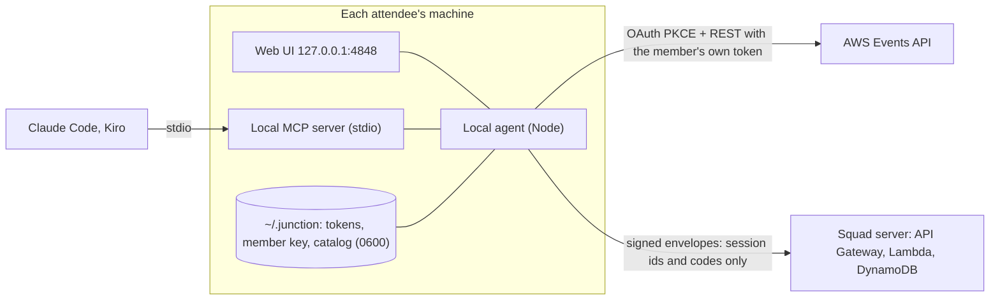

# Junction

**Cover re:Invent as a team without sharing accounts.**

Junction is a squad-coordination tool for AWS re:Invent 2026, built on the new AWS Events API for the re:Invent Event Catalog API Hackathon. A group of attendees (a team, a user group, a few Community Builders) decide together who covers which topics, and Junction shows them, day by day, what nobody covers, which sessions two of them booked by accident, which walks between venues cannot be made, and which repeat to move to so the squad covers more. Each person keeps their own Builder ID sign-in and their own schedule. Nobody's account is shared.

- **Demo, no sign-in, fictional data:** https://junction.gerardo.dev/demo/
- **Landing:** https://junction.gerardo.dev


## Why

Teams that travel to re:Invent plan alone. Five people from the same company end up in the same chalk talk, nobody goes to the security session the team needed, and somebody books MGM Grand at 2:00 and Wynn at 2:15. The re:Invent app is personal by design. The AWS Events API is personal by design too: it acts only for the signed-in attendee and only from their own machine ("it has to run locally").

Junction turns that constraint into the design. It does not ask anybody for their credentials, and it has no central server that sees schedules. Each member runs a small local agent, and members exchange **signed lists of session codes**. Every agent runs the same deterministic solver on the same inputs, so every member sees the same proposals without a coordinator.

## How it works



1. **Local agent.** Signs in with AWS Builder ID using OAuth 2.0 with PKCE on a loopback port (8484, falling back through 8489). It downloads the catalog into a local SQLite file, reads the member's schedule, and serves the UI at `127.0.0.1:4848`. Tokens never leave the machine and the browser never sees them.
2. **Signed picks.** The agent turns `GetSchedule` into a *manifest*: session ids and codes, priorities and holds, signed with the member's Ed25519 key. No titles, rooms, speakers, emails or tokens. Titles are resolved on each machine from its own catalog.
3. **Deterministic consensus.** The solver (`packages/core`) is a pure function of (squad rules, manifests, catalog snapshot): integer arithmetic, no clock, no randomness, code-point ordering. Same inputs give byte-identical proposals on every machine, checked with property tests. Proposals are SWAP (move to a repeat), CLAIM (take an uncovered must-cover or new session, owner chosen by a deterministic claim rule) and DROP (release an unplanned duplicate).
4. **Squad server (optional mailbox).** A serverless relay (API Gateway HTTP API, Lambda on arm64, DynamoDB with TTL, deployed with CDK) stores only the signed envelopes. Every request is signed with the member key and checked against the leader-signed squad rules. It never calls the Events API. If it is down, members paste a `junction1:` block into chat instead.
5. **Accepting a proposal** changes only your own schedule: it adds the new session first (favorite, or reservation with `--reserve`), removes the old one only if the add held, then confirms everything from `GetSchedule` and reports per session. It can be undone.

## How it uses the AWS Events API

All 12 operations of the REST API are used, each through the agent, paced with per-operation token buckets at the published per-attendee quotas.

| Operation | Where Junction uses it |
|---|---|
| `ListEvents` | `junction doctor` checks the API and that `reinvent2026` is listed |
| `GetEvent` | Event timezone, to place session times and convert to the event-local day |
| `ListSessions` | Full catalog walk with `includeAbstracts=false`, paginated until `nextToken` is absent; diffs between walks feed CLAIM for new sessions |
| `GetSession` | `junction session <code>`: abstract and seat availability on demand |
| `GetSchedule` | Source of truth for signed picks, and the reconciliation read after every write |
| `AssociateFavorites` | Accepting a SWAP or CLAIM (batches of at most 10, partial failure reported per session) |
| `DisassociateFavorite` | Releasing the old session of a SWAP, a DROP, undo |
| `ReserveSessions` | `junction accept <id> --reserve`, restoring a reservation on undo |
| `CancelReservation` | Releasing a reserved session after its replacement held |
| `CreatePersonalTime` | Squad meeting points, tagged `jn1-meet-…` so Junction finds its own entries (create returns no id) |
| `UpdatePersonalTime` | Moving a meeting point, only for entries carrying Junction's tag |
| `DeletePersonalTime` | Removing a meeting point, confirmed from `GetSchedule` afterwards |

What the API taught us, and how Junction handles it (details in [`docs/FINDINGS.md`](docs/FINDINGS.md)):

- **No idempotency key.** Nothing is retried blindly. A 5xx on a write is an *unknown outcome* and is reconciled with `GetSchedule`. `CreatePersonalTime` reads the schedule first and skips if its tag already exists.
- **Bulk operations succeed per session.** A 200 is never reported as "done"; every session gets its own line, confirmed from `GetSchedule`.
- **A 204 on delete is not proof.** In our spike one `DeletePersonalTime` returned 204 and the entry stayed, so deletes are confirmed too.
- **Personal time is event-local wall clock** (`YYYY-MM-DDTHH:MM:00`, no `Z`), and a description starting with `[` was refused, so the ownership tag uses letters, digits and hyphens.
- **`409` means closed, not broken.** **`403` with a JSON body** means not registered; **without a body** it is the edge refusing the address. The edge can answer with HTML, so the client never assumes JSON.
- **The catalog is not public.** It is stored only on each attendee's machine and is never committed, logged or sent to the squad server. The demo uses invented sessions from a seeded generator.
- Real catalog shape: 2476 sessions in 10 pages, five venues this year (Wynn/Encore, Venetian, Caesars Forum, Caesars Palace, MGM Grand), and repeats with suffixes `-R`, `-R1`, `-S`, `-D1` that can differ in format.

## Run it

Requirements: Node.js 22.13 or later (for `node:sqlite`), npm 10, a browser signed in to AWS Builder ID, and a re:Invent 2026 registration for real data. Windows, macOS and Linux.

```bash
git clone https://github.com/codecr/junction-hackhaton.git
cd junction-hackhaton
npm ci
npm run build:web           # builds the UI the agent serves, and the demo

npm run junction -- login   # opens Builder ID sign-in; tokens go to ~/.junction (0600)
npm run junction -- catalog refresh
npm run junction -- whoami --name "Your name"
```

Start a squad (the leader):

```bash
npm run junction -- squad create "Pura Vida builders" --topics topics.json --lunch 12:00-13:00
npm run junction -- squad server            # use the hosted squad server (optional)
npm run junction -- squad invite            # prints: junction squad join sq_….<secret>
```

`topics.json` lists what the squad wants covered, matched against the catalog's own labels:

```json
[
  { "id": "ai", "label": "Artificial Intelligence", "weight": 5, "target": 2, "match": { "topics": ["Artificial Intelligence"] } },
  { "id": "security", "label": "Security & Identity", "weight": 4, "target": 1, "match": { "topics": ["Security & Identity"] } }
]
```

Join a squad (each member):

```bash
npm run junction -- squad join sq_xxxxxxxxxxxxxxxx.<secret>   # through the squad server
# leader: npm run junction -- squad requests, then squad approve m_<member id>
npm run junction -- sync
```

Without the squad server, `squad join <secret>` prints a block to send to the leader, `squad approve <block>` adds the member, and `squad export` / `squad import` move `junction1:` blocks through any chat.

Every day:

```bash
npm run junction -- sync            # read your schedule, sign your picks, exchange, recompute
npm run junction -- status          # coverage, duplicates, walks you cannot make
npm run junction -- proposals       # yours, with ids (add --all for the squad's)
npm run junction -- accept <id>     # applies it to your own schedule, confirmed per session
npm run junction -- undo <id>
npm run junction -- meet add "Squad lunch" --date 2026-12-01 --start 12:30 --end 13:15 --at "Venetian"
npm run dev                         # the squad day view at http://127.0.0.1:4848
```

### Ask your assistant

The local MCP server exposes `squad_coverage`, `squad_gaps`, `squad_proposals`, `squad_accept` (requires `confirm: true`) and `squad_sync`, reading only local state. It complements the official `awsevents` MCP server. For Claude Code:

```bash
claude mcp add junction -- npx tsx /path/to/junction-hackhaton/packages/mcp/src/index.ts
```

Then ask "who covers security on Wednesday?" or "what should I change tomorrow?".

### Demo without signing in

```bash
npm run demo        # http://localhost:5173/demo/ with the fictional squad
```

The demo build runs the same solver in the browser and ships a `connect-src 'none'` Content Security Policy, so it cannot make network requests at all.

## Repository

| Path | What |
|---|---|
| `packages/core` | Pure TypeScript: zod schemas, RFC 8785 canonical JSON, Ed25519 envelopes, code parser, repeat groups, venue graph, coverage, solver, claim rule, squad view |
| `packages/agent` | Builder ID sign-in, Events API client and pacer, SQLite catalog, signed picks, accept/undo with reconciliation, personal time, squad server transport, CLI, local UI server |
| `packages/web` | React and Vite UI on plain CSS tokens: the Marey-style day chart, coverage, proposals; agent and demo builds |
| `packages/mcp` | Local stdio MCP server |
| `packages/relay` | Squad server Lambda handler, DynamoDB store, signed client |
| `infra` | AWS CDK v2: relay stack, alarms, budget, custom domain |
| `site` | Landing page; Amplify Hosting assembles it with the demo (`amplify.yml`) |
| `fixtures` | Seeded generator for the fictional demo squad |
| `docs` | Spec, architecture and decision records, data contracts, API notes, findings, design |

Checks: `npm run typecheck`, `npm test` (440 tests, including fast-check property tests for solver determinism, feasibility and independence of proposals), `npm run lint`, `npm run shots` (Playwright screenshots at 1440 and 390), `npm run infra:synth`. A pre-commit hook refuses catalog or private data.

Deploy the squad server: `aws sso login`, then `npm run infra:diff` and `npm run infra:deploy` (add `-c hostedZoneId=… -c hostedZoneName=…` for the custom domain). The site is static: `npm run build:demo -w @junction/web && npm run site` assembles `site-dist/`, which is published to Amplify Hosting (a manual deployment today, see ADR-021; `amplify.yml` is ready for a Git-connected app).

## Privacy

| Leaves your machine | Never leaves your machine |
|---|---|
| Signed session ids and codes, priorities, holds; busy blocks or venue only if you choose sharing level L1 or L2 | Access, refresh and ID tokens |
| Squad name, member display names, topic labels | Session titles, abstracts, speakers, rooms |
| | The catalog, your email |

The squad server's API Gateway access logs keep the caller's IP address, route and status for 30 days (no headers, no bodies). Everything in the squad server expires 14 days after the event.

## Disclaimer

Junction is an unofficial community project built for the re:Invent Event Catalog API Hackathon. It is not affiliated with or endorsed by Amazon Web Services. It uses the AWS Events API on behalf of each signed-in attendee and stores no catalog content. "AWS" and "re:Invent" are trademarks of Amazon.com, Inc. or its affiliates.

## License

[MIT](LICENSE)
